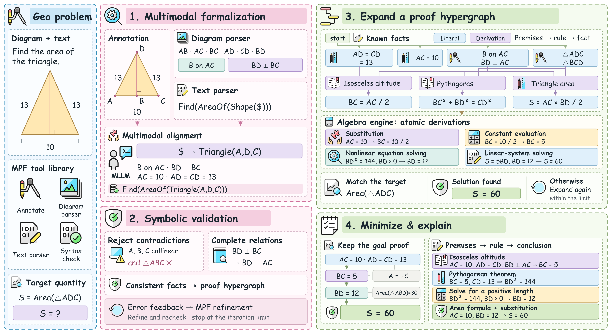
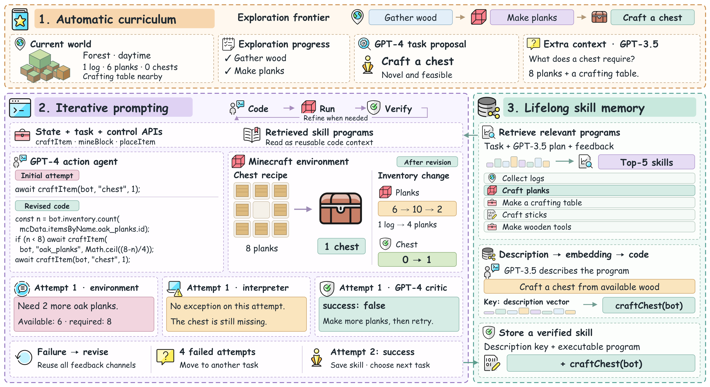

<div align="center">

# Diagram4Papers

### 把研究方法画成可编辑的论文图。

一个从论文与代码出发，组织内容、设计构图并检查实际渲染的绘图 Skill。

[English](README.md) · [简体中文](README_zh-CN.md)

[](LICENSE)
[](#示例)
[](#重建示例)

[查看示例](#示例) · [开始使用](#开始使用) · [绘图方法](#绘图方法)

</div>

---

Diagram4Papers 帮助编程 Agent 判断**一张方法图该讲什么，以及如何把它画清楚**。它从论文和相关代码中梳理机制，用一个具体例子串联中间变化，再通过结构图、参数映射、代码片段和验证证据组织解释。最终交付可编辑的 `.drawio` 文件和原生导出的 PNG。

默认画风饱满而有序：主体图形有足够的视觉分量，分区精确对齐，浅色背景与多彩细节协调搭配，使用 Comic Sans MS 和层级清楚的圆角虚线框。版面根据内容安排，辅助输入可以收成窄条，难以解释的机制则得到更大的展示空间。

## 示例

以下图片根据公开论文的方法独立设计，用于展示 Skill 的视觉思路。它们没有复刻论文原图，也不代表系统的真实运行记录。

### AutoGPS · 几何推理

从几何题面出发，展示多模态形式化、符号验证、证明图扩展和简洁解答的形成过程。



[原论文](https://arxiv.org/abs/2505.23381) · [可编辑 draw.io](examples/autogps.drawio) · [完整 PNG](examples/autogps.png) · [内容依据与设计说明](examples/design-notes.md)

图中使用论文公开的 13–13–10 三角形作为贯穿示例，展开定理所需的前提、原子代数操作，以及目标证明需要保留的依赖。推导经过本地计算检查，属于教学性说明。

### Voyager · 具身终身学习

用“制作箱子”的任务，串联自动课程、代码修正、执行反馈、结果验证和技能记忆。



[原论文](https://arxiv.org/abs/2305.16291) · [可编辑 draw.io](examples/voyager.drawio) · [完整 PNG](examples/voyager.png) · [内容依据与设计说明](examples/voyager-notes.md)

杏色、淡紫与青绿的布局将主要空间留给代码和环境之间的交互。场景、配方和库存变化为示意绘制，模型反馈与检索条目也属于说明性示例。代码片段改编自公开的 MIT 许可程序；离线检查没有运行 Minecraft 或调用大模型。

<sub>两张示例的图标来自 <a href="https://www.streamlinehq.com/">Free icons from Streamline</a>，采用 <a href="https://creativecommons.org/licenses/by/4.0/">CC BY 4.0</a> 许可。方法归原论文作者所有；论文来源与代码署名见 <a href="THIRD_PARTY_NOTICES.md">第三方声明</a>。</sub>

## 开始使用

### 安装到 Codex

将仓库克隆到 Skills 目录：

```sh
git clone https://github.com/wendinggao/Diagram4Papers.git "${CODEX_HOME:-$HOME/.codex}/skills/diagram4papers"
```

下一轮对话即可使用。入口文件是 [SKILL.md](SKILL.md)，调用名为 `diagram4papers`。

### 提供论文和绘图任务

```text
$diagram4papers
请阅读这篇论文及相关实现，绘制一张方法总览图。
选择一个具体例子，展示关键的中间变化。
画风参考随包示例，根据当前方法设计布局和配色，检查 draw.io 实际渲染。
交付可编辑 .drawio 文件和独立 PNG。

论文：<链接或文件>
代码：<可选仓库>
参考图：<可选图片>
```

也可以提供已有 `.drawio` 文件，说明要修改的局部，以及需要保留的内容或布局。绘制新图时，目标版面尺寸和喜欢的参考图有助于确定最终展示尺度。

**适用范围：**论文方法图、架构图和流程图。统计图表与演示文稿需要使用其他工作流。目前已在 Codex 中验证；核心说明是 Markdown，其他 Agent 可以读取，但需要根据自身环境调整工具调用。

## 绘图方法

| 设计环节 | Skill 的处理方式 |
|---|---|
| 选择内容 | 阅读方法与相关代码，确定贯穿示例和值得展示的中间变化。 |
| 局部构图 | 用适合当前关系的图形，组合对象、操作与可见结果。 |
| 安排版面 | 为关键机制分配空间，对齐分区，并通过重排回收无效留白。 |
| 使用图标 | 为具体对象和操作选用专业素材，与可编辑的科学图形共同解释内容。 |
| 配色与层级 | 用浅色大底衬托多彩细节，通过分层边框组织相关内容。 |
| 渲染迭代 | 将实际渲染与参考图放在相近显示尺度下比较，修改影响观感的设计决定。 |

随包示例提供视觉参照，新的论文仍需要重新组织内容和构图。最终效果取决于 Agent 对方法的理解、素材选择，以及对实际图片的检查与修改。

## 重建示例

**环境要求：**Python 3.9+，以及能访问 diagrams.net 嵌入页面的现代浏览器；也可以使用桌面版 draw.io 导出。要保持相同字体，渲染系统需要安装 Comic Sans MS，仓库不分发字体文件。Pillow 可用于可选的字体宽度检查；Node.js 仅用于 Voyager 的离线资源模拟测试。

在仓库根目录运行：

```sh
python3 -B scripts/build_demo.py --out demo-output/autogps.drawio
python3 -B scripts/check_figure.py demo-output/autogps.drawio --assets assets/streamline/ledger.json --require-font
python3 -B scripts/preview.py demo-output/autogps.drawio --port 0 --scale 2
```

在浏览器打开终端给出的本地地址，预览页会将原生 PNG 导出到图文件旁。此过程运行临时本地服务，渲染浏览器需要能够访问 `embed.diagrams.net`。也可以改用桌面版 draw.io 导出。

重建 Voyager 时，将上述命令中的构建脚本换成 `scripts/build_voyager.py`，图文件路径换成 `demo-output/voyager.drawio`。构建脚本还会保存说明性轨迹。绘制新图时可使用底层的[绘图辅助脚本](scripts/figure.py)，内容选择与构图仍需根据论文设计。

<details>
<summary><strong>验证与仓库结构</strong></summary>

```sh
python3 -B -m unittest discover -s tests -v
node tests/test_voyager_program.js
```

发布检查应在不含 Git 元数据的导出目录中运行。可选的 `--deny-file` 参数支持从该目录之外提供私有敏感词。工具检查几何、样式一致性、素材来源和发布内容，视觉效果需要另外查看实际图片。[验证记录](RELEASE-CHECKS.md)说明了已有检查及其边界。

| 路径 | 内容 |
|---|---|
| [SKILL.md](SKILL.md) | Skill 的绘图流程与参考文档入口。 |
| [references/](references/) | 内容选择、构图、配色、素材与迭代方法。 |
| [scripts/](scripts/) | draw.io 辅助工具、示例构建、检查与浏览器导出。 |
| [examples/](examples/) | 可编辑图、PNG 和内容依据、设计说明。 |
| [assets/streamline/](assets/streamline/) | 具有来源记录的专业图标素材。 |

</details>
